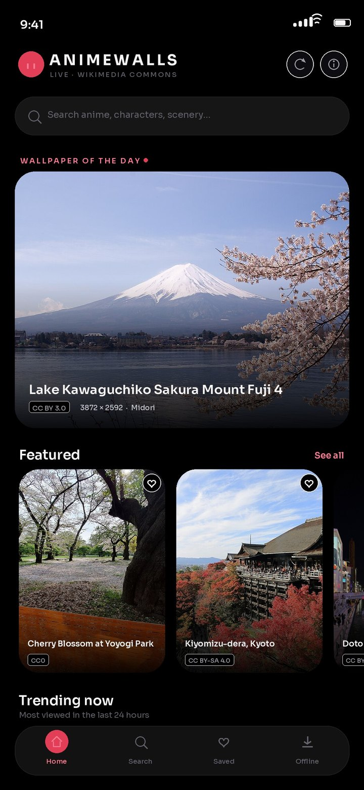
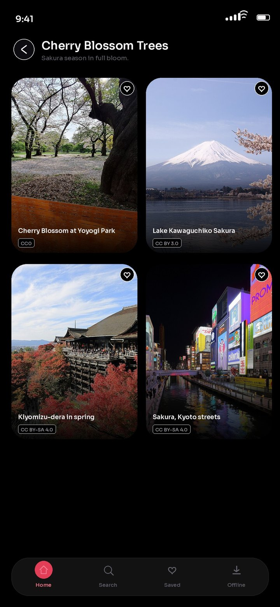
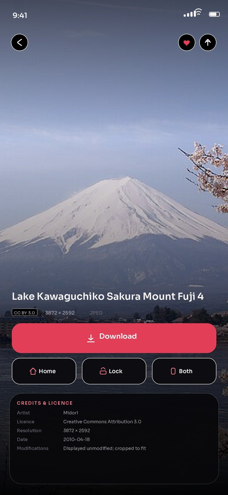
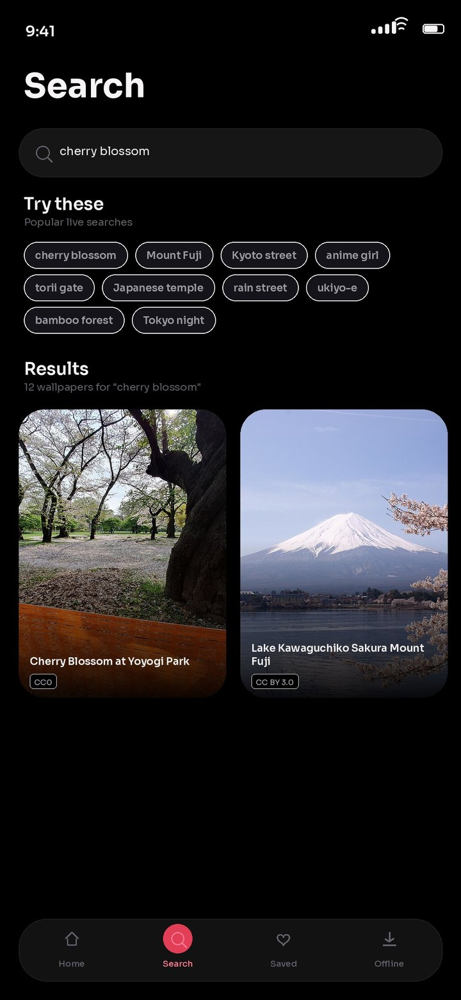
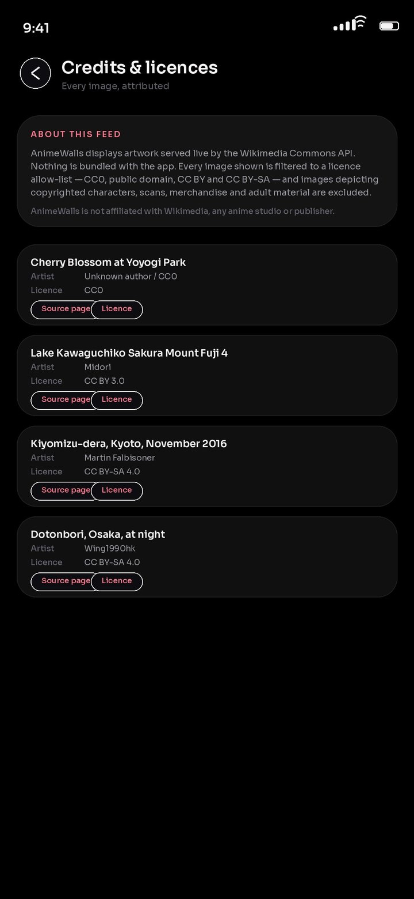

# AnimeWalls

A premium anime wallpaper app for Android — Kotlin, Jetpack Compose, Material 3,
an AMOLED-black glass interface, and a feed that streams **live** from the
Wikimedia Commons API with verified licensing on every image.

**Download:** [latest release](https://github.com/technicalnihilist-lgtm/AnimeWalls/releases/latest) · Android 7.0+ (API 24) · 11 MB

<p align="center">
  
  
  
  
</p>
<p align="center">
  
</p>

<sub>Previews rendered from the app's own design tokens, typeface and live
Commons artwork at 1080×2340. They are design renders, not device captures —
the build environment had no emulator.</sub>

---

## Why some categories are empty

Wikimedia Commons does not host freely licensed artwork of Naruto, Luffy, Goku
or any other copyrighted character. Searching for them returns cosplay
photographs, murals, DVD scans and franchise logos — none of which the app may
redistribute, because a licence on a *photograph* grants nothing in the
*character* it depicts.

So those pages show an explanation instead of an image. The scenery, ukiyo-e
and original anime-style illustration collections are full of genuine,
verifiable content.

---

## Build

```bash
./gradlew :app:assembleDebug        # debug APK
./gradlew :app:assembleRelease      # minified release APK (signed with the debug key)
```

Requirements: JDK 17, Android SDK 34 (`compileSdk 34`, `minSdk 24`, `targetSdk 34`).

Install the debug build with:

```bash
adb install -r AnimeWalls-1.0.0.apk   # from the release page
```

---

## How images are sourced and checked

The app calls `https://commons.wikimedia.org/w/api.php` with
`generator=search` over the `File` namespace, requesting `imageinfo` with
`url|size|mime|sha1|extmetadata`. Each result passes through
`LicensePolicy` (`domain/license/LicensePolicy.kt`) before it can be displayed:

1. **Licence allow-list** — only CC0, public domain, CC BY and CC BY-SA are
   accepted. Anything marked NC (non-commercial) or ND (no derivatives) is
   rejected, because the app may be distributed commercially and wallpapers are
   cropped to fit a screen.
2. **Adult-content block-list** — explicit material is excluded outright.
3. **Rights in the depicted work** — files naming a copyrighted franchise
   (Naruto, One Piece, Dragon Ball, Demon Slayer, Jujutsu Kaisen, Attack on
   Titan, and the rest of the catalogue) are rejected, as are cosplay, murals,
   scans, screenshots, logos, merchandise and figures. A Commons licence on a
   *photograph* does not grant rights in the *character* it depicts.
4. **Relevance** — every distinctive token of the query must appear in the
   file's title, description or Commons categories, which keeps unrelated
   results out of a category.
5. **Wallpaper quality** — at least 1200×900 (or 900×1600 portrait) and an
   aspect ratio between 0.4 and 2.6.

Anything that fails is dropped. That is why the "Popular Anime" and "Anime
Characters" pages are usually empty: Wikimedia Commons does not host freely
licensed artwork of those characters, so the app shows an explanation instead
of showing an image it has no right to show. The scenery, ukiyo-e and
original anime-style illustration collections are full of genuine, verifiable
content.

### Attribution

Each wallpaper carries its title, artist, credit line, licence name, licence
URL, original file page URL and creation date, all copied verbatim from
`extmetadata`. They appear on the detail screen and in the **Credits** screen.
Images are displayed unmodified; thumbnails are generated by Wikimedia and the
app crops them to fit the screen, which is stated on every detail page.

---

## Architecture

```
data/
  remote/       Retrofit API + DTOs + mapper (Commons -> Wallpaper)
  repository/   Live paging, retry, de-duplication, local library access
  local/        Room entities, DAOs, database (favourites, downloads, recents)
  download/     Application-scoped downloader with progress
  wallpaper/    WallpaperManager integration (home / lock / both)
domain/
  license/      LicensePolicy — the single compliance gate
  catalog/      Category tree and its live search queries
  model/        Wallpaper, PageResult, WallpaperCategory
ui/
  theme/        AMOLED palette + Sora typography
  components/   Glass cards, wallpaper cards, rails, grids, empty states
  screens/      home, search, category, detail, library, credits
di/             ServiceLocator (hand-rolled, no reflection)
```

- **Pagination** is offset-based (`gsroffset`). Because the filter removes many
  raw hits, the repository keeps pulling raw pages until it has enough usable
  items, bounded to keep latency predictable.
- **Retry** wraps every API call (3 attempts, linear backoff) and surfaces a
  readable message when the network is unavailable.
- **Caching** is two-layer: an OkHttp disk cache for API responses and Coil's
  memory/disk cache for images.
- **De-duplication** uses the file's SHA-1 as the identity: it is the primary
  key in Room and the key of every list, so a wallpaper can never appear twice
  or be saved twice.
- **Memory** — full-resolution originals can be 11000 px wide, so setting a
  wallpaper decodes with `inSampleSize` against the screen size rather than
  loading the original into the heap.

---

## Features

- Live home feed: featured, trending, popular characters, scenery, dark and
  aesthetic collections, recently added, and a wallpaper of the day that
  changes daily.
- Search with debounce, suggestions and infinite scroll.
- 47 categories across Popular Anime, Anime Characters, Anime Scenery and
  Special Collections.
- Detail screen: full-screen preview, download, set as home / lock / both,
  favourite, share (the downloaded file via FileProvider, otherwise the source
  link), resolution, artist, licence and source links.
- Favourites, downloads and recently-viewed persisted in Room.
- Offline access to downloaded wallpapers.
- Credits screen listing every image with full attribution.

---

## Verified against the live API

`tools/verify_catalog.py` mirrors the app's filter in Python and was run against
`commons.wikimedia.org` to tune every category query. Current live counts
(kept after all checks, per category, one raw page each):

| Collection | Results |
|---|---|
| Cherry Blossom Trees | 45 |
| Anime Forests | 37 |
| Traditional Japanese Houses | 37 |
| Sunset Landscapes | 36 |
| Anime Night Sky | 28 |
| Japanese Streets | 16–27 |
| Fantasy Anime (ukiyo-e) | 16–21 |
| Anime Girls | 14 |
| Naruto / One Piece / Gojo Satoru | 0 (all rejected as copyrighted characters) |

---

## Not affiliated

AnimeWalls is not affiliated with Wikimedia, any anime studio or publisher.
Image rights remain with their respective authors; the app only ever displays
material whose licence permits redistribution, with attribution.
