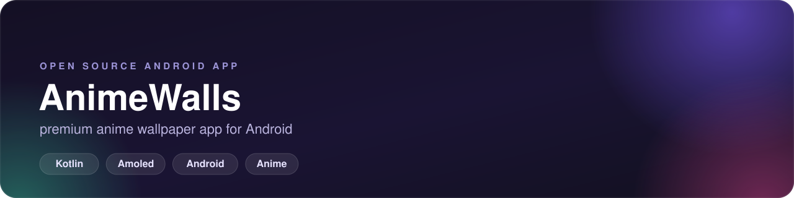

<div align="center">




<a href="https://github.com/technicalnihilist-lgtm/AnimeWalls/stargazers"></a>&nbsp;<a href="https://github.com/technicalnihilist-lgtm/AnimeWalls/network/members"></a>

<a href="https://github.com/technicalnihilist-lgtm/AnimeWalls/releases/latest"></a>

<b>Support the work</b>

  

<sub>Donations aren't live yet — Paytm, UPI, PayPal and Buy&nbsp;Me&nbsp;a&nbsp;Coffee all show <b>coming soon</b>. Until then, a ⭐ star is the best support.</sub>

<a href="https://github.com/technicalnihilist-lgtm/AnimeWalls/releases/latest"></a>  <a href="https://github.com/technicalnihilist-lgtm/AnimeWalls/releases"></a>

</div>

---

## Why some categories are empty

Wikimedia Commons does not host freely licensed artwork of Naruto, Luffy, Goku
or any other copyrighted character. Searching for them returns cosplay
photographs, murals, DVD scans and franchise logos — none of which the app may
redistribute, because a licence on a *photograph* grants nothing in the
*character* it depicts.

So those pages show an explanation instead of an image. The scenery, ukiyo-e
and original anime-style illustration collections are full of genuine,
verifiable content.

---

## Build

```bash
./gradlew :app:assembleDebug        # debug APK
./gradlew :app:assembleRelease      # minified release APK (signed with the debug key)
```

Requirements: JDK 17, Android SDK 34 (`compileSdk 34`, `minSdk 24`, `targetSdk 34`).

Install the debug build with:

```bash
adb install -r AnimeWalls-1.0.0.apk   # from the release page
```

---

## How images are sourced and checked

The app calls `https://commons.wikimedia.org/w/api.php` with
`generator=search` over the `File` namespace, requesting `imageinfo` with
`url|size|mime|sha1|extmetadata`. Each result passes through
`LicensePolicy` (`domain/license/LicensePolicy.kt`) before it can be displayed:

1. **Licence allow-list** — only CC0, public domain, CC BY and CC BY-SA are
   accepted. Anything marked NC (non-commercial) or ND (no derivatives) is
   rejected, because the app may be distributed commercially and wallpapers are
   cropped to fit a screen.
2. **Adult-content block-list** — explicit material is excluded outright.
3. **Rights in the depicted work** — files naming a copyrighted franchise
   (Naruto, One Piece, Dragon Ball, Demon Slayer, Jujutsu Kaisen, Attack on
   Titan, and the rest of the catalogue) are rejected, as are cosplay, murals,
   scans, screenshots, logos, merchandise and figures. A Commons licence on a
   *photograph* does not grant rights in the *character* it depicts.
4. **Relevance** — every distinctive token of the query must appear in the
   file's title, description or Commons categories, which keeps unrelated
   results out of a category.
5. **Wallpaper quality** — at least 1200×900 (or 900×1600 portrait) and an
   aspect ratio between 0.4 and 2.6.

Anything that fails is dropped. That is why the "Popular Anime" and "Anime
Characters" pages are usually empty: Wikimedia Commons does not host freely
licensed artwork of those characters, so the app shows an explanation instead
of showing an image it has no right to show. The scenery, ukiyo-e and
original anime-style illustration collections are full of genuine, verifiable
content.

### Attribution

Each wallpaper carries its title, artist, credit line, licence name, licence
URL, original file page URL and creation date, all copied verbatim from
`extmetadata`. They appear on the detail screen and in the **Credits** screen.
Images are displayed unmodified; thumbnails are generated by Wikimedia and the
app crops them to fit the screen, which is stated on every detail page.

---

## Architecture

```
data/
  remote/       Retrofit API + DTOs + mapper (Commons -> Wallpaper)
  repository/   Live paging, retry, de-duplication, local library access
  local/        Room entities, DAOs, database (favourites, downloads, recents)
  download/     Application-scoped downloader with progress
  wallpaper/    WallpaperManager integration (home / lock / both)
domain/
  license/      LicensePolicy — the single compliance gate
  catalog/      Category tree and its live search queries
  model/        Wallpaper, PageResult, WallpaperCategory
ui/
  theme/        AMOLED palette + Sora typography
  components/   Glass cards, wallpaper cards, rails, grids, empty states
  screens/      home, search, category, detail, library, credits
di/             ServiceLocator (hand-rolled, no reflection)
```

- **Pagination** is offset-based (`gsroffset`). Because the filter removes many
  raw hits, the repository keeps pulling raw pages until it has enough usable
  items, bounded to keep latency predictable.
- **Retry** wraps every API call (3 attempts, linear backoff) and surfaces a
  readable message when the network is unavailable.
- **Caching** is two-layer: an OkHttp disk cache for API responses and Coil's
  memory/disk cache for images.
- **De-duplication** uses the file's SHA-1 as the identity: it is the primary
  key in Room and the key of every list, so a wallpaper can never appear twice
  or be saved twice.
- **Memory** — full-resolution originals can be 11000 px wide, so setting a
  wallpaper decodes with `inSampleSize` against the screen size rather than
  loading the original into the heap.

---

## Features

- Live home feed: featured, trending, popular characters, scenery, dark and
  aesthetic collections, recently added, and a wallpaper of the day that
  changes daily.
- Search with debounce, suggestions and infinite scroll.
- 47 categories across Popular Anime, Anime Characters, Anime Scenery and
  Special Collections.
- Detail screen: full-screen preview, download, set as home / lock / both,
  favourite, share (the downloaded file via FileProvider, otherwise the source
  link), resolution, artist, licence and source links.
- Favourites, downloads and recently-viewed persisted in Room.
- Offline access to downloaded wallpapers.
- Credits screen listing every image with full attribution.

---

## Verified against the live API

`tools/verify_catalog.py` mirrors the app's filter in Python and was run against
`commons.wikimedia.org` to tune every category query. Current live counts
(kept after all checks, per category, one raw page each):

| Collection | Results |
|---|---|
| Cherry Blossom Trees | 45 |
| Anime Forests | 37 |
| Traditional Japanese Houses | 37 |
| Sunset Landscapes | 36 |
| Anime Night Sky | 28 |
| Japanese Streets | 16–27 |
| Fantasy Anime (ukiyo-e) | 16–21 |
| Anime Girls | 14 |
| Naruto / One Piece / Gojo Satoru | 0 (all rejected as copyrighted characters) |

---

## Not affiliated

AnimeWalls is not affiliated with Wikimedia, any anime studio or publisher.
Image rights remain with their respective authors; the app only ever displays
material whose licence permits redistribution, with attribution.

---

## 🌍 Languages

<sub>Donations are <b>coming soon</b> in every language below — nothing to pay today, nothing to click.</sub>

<div align="center">

<sub><b>हिन्दी · বাংলা · मराठी · తెలుగు · தமிழ் · ગુજરાતી · ಕನ್ನಡ · മലയാളം · ਪੰਜਾਬੀ · ଓଡ଼ିଆ · অসমীয়া · اردو</b></sub>

</div>

<details>
<summary><b>🌍 Open the same message in 53 languages</b></summary>

**🇮🇳 Indian languages**

- **हिन्दी** (Hindi) — ☕ जल्द ही आ रहा है। · ⭐ अगर आपको यह ऐप और हमारा काम पसंद है, तो कृपया रिपॉजिटरी को स्टार दें और हमें फॉलो करें।
- **বাংলা** (Bengali) — ☕ খুব শিগগিরই আসছে। · ⭐ যদি আপনার এই অ্যাপ এবং আমাদের কাজ ভালো লাগে, তবে অনুগ্রহ করে রিপোজিটরিটিকে একটি স্টার দিন এবং আমাদের ফলো করুন।
- **मराठी** (Marathi) — ☕ लवकरच येत आहे. · ⭐ जर तुम्हाला हे ॲप आणि आमचं काम आवडलं असेल, तर कृपया रिपॉझिटरीला स्टार द्या आणि आम्हाला फॉलो करा.
- **తెలుగు** (Telugu) — ☕ త్వరలో రాబోతోంది. · ⭐ మీకు ఈ యాప్, మా పని నచ్చితే, దయచేసి రిపోజిటరీకి ఒక స్టార్ ఇచ్చి మమ్మల్ని ఫాలో అవ్వండి.
- **தமிழ்** (Tamil) — ☕ விரைவில் வருகிறது. · ⭐ உங்களுக்கு இந்த ஆப்பும் எங்க வேலையும் பிடிச்சிருந்தா, தயவுசெஞ்சு இந்த ரெபாசிட்டரிக்கு ஒரு ஸ்டார்…
- **ગુજરાતી** (Gujarati) — ☕ ટૂંક સમયમાં આવી રહ્યું છે. · ⭐ જો તમને આ એપ અને અમારું કામ ગમતું હોય, તો પ્લીઝ રિપોઝિટરીને સ્ટાર આપો અને અમને ફોલો કરો.
- **ಕನ್ನಡ** (Kannada) — ☕ ಶೀಘ್ರದಲ್ಲೇ ಬರುತ್ತಿದೆ. · ⭐ ನಿಮಗೆ ಈ ಆ್ಯಪ್ ಮತ್ತು ನಮ್ಮ ಕೆಲಸ ಇಷ್ಟವಾದರೆ, ದಯವಿಟ್ಟು ರೆಪೊಸಿಟರಿಗೆ ಸ್ಟಾರ್ ಕೊಡಿ ಮತ್ತು ನಮ್ಮನ್ನು ಫಾಲೋ ಮಾಡಿ.
- **മലയാളം** (Malayalam) — ☕ ഉടൻ വരുന്നു. · ⭐ നിങ്ങൾക്ക് ഈ ആപ്പും ഞങ്ങളുടെ പ്രവർത്തനവും ഇഷ്ടപ്പെട്ടെങ്കിൽ, ദയവായി റെപ്പോസിറ്ററിക്ക് ഒരു സ്റ്റാർ…
- **ਪੰਜਾਬੀ** (Punjabi) — ☕ ਜਲਦੀ ਆ ਰਿਹਾ ਹੈ। · ⭐ ਜੇ ਤੁਹਾਨੂੰ ਇਹ ਐਪ ਅਤੇ ਸਾਡਾ ਕੰਮ ਪਸੰਦ ਹੈ, ਤਾਂ ਕਿਰਪਾ ਕਰਕੇ ਰਿਪੋਜ਼ਟਰੀ ਨੂੰ ਸਟਾਰ ਦਿਓ ਅਤੇ ਸਾਨੂੰ ਫਾਲੋ ਕਰੋ।
- **ଓଡ଼ିଆ** (Odia) — ☕ ଖୁବ୍ ଶୀଘ୍ର ଆସୁଛି। · ⭐ ଯଦି ଆପଣଙ୍କୁ ଏହି ଆପ୍ ଏବଂ ଆମର କାମ ଭଲ ଲାଗୁଛି, ତେବେ ଦୟାକରି ରିପୋଜିଟୋରୀକୁ ଗୋଟିଏ ଷ୍ଟାର୍ ଦିଅନ୍ତୁ ଏବଂ ଆମକୁ ଫଲୋ କରନ୍ତୁ।
- **অসমীয়া** (Assamese) — ☕ অতি সোনকালেই আহি আছে। · ⭐ যদি আপুনি এই এপটো আৰু আমাৰ কাম ভাল পায়, তেন্তে অনুগ্ৰহ কৰি ৰিপজিটৰীটোক এটা ষ্টাৰ দিয়ক আৰু আমাক ফ'ল' কৰক।
- **اردو** (Urdu) — ☕ جلد آرہا ہے۔ · ⭐ اگر آپ کو یہ ایپ اور ہمارا کام پسند آئے تو براہ کرم ریپازٹری کو سٹار دیں اور ہمیں فالو کریں۔
- **संस्कृतम्** (Sanskrit) — ☕ शीघ्रमेव आगच्छति।
- **मैथिली** (Maithili) — ☕ जल्दिये आबि रहल अछि।
- **कोंकणी** (Konkani) — ☕ रोखडेंच येता.
- **کٲشُر** (Kashmiri) — ☕ جَلدی یِوان چھُ۔
- **سنڌي** (Sindhi) — ☕ जल्द अची रह्यो आहे।
- **डोगरी** (Dogri) — ☕ जल्दी आ करदा ऐ।
- **ꯃꯤꯇꯩ ꯂꯣꯟ** (Manipuri) — ☕ ꯑꯊꯨꯕꯥ ꯃꯇꯝꯗꯥ ꯂꯥꯛꯀꯅꯤ꯫
- **बर’** (Bodo) — ☕ थाबैनो फैगोन।
- **ᱥᱟᱱᱛᱟᱲᱤ** (Santali) — ☕ ᱞᱚᱜᱚᱱ ᱦᱤᱡᱩᱜ ᱠᱟᱱᱟ᱾
- **नेपाली** (Nepali) — ☕ छिट्टै आउँदैछ। · ⭐ यदि तपाईंलाई यो एप र हाम्रो काम मन पर्‍यो भने, कृपया रिपोजिटरीलाई स्टार दिनुहोस् र हामीलाई फलो गर्नुहोस्।

**🌍 World languages**

- **العربية** (Arabic) — ☕ قريبًا. · ⭐ إذا أعجبك هذا التطبيق وعملنا، فيرجى منح المستودع نجمة ومتابعتنا.
- **简体中文** (Chinese (Simplified)) — ☕ 即将推出。
- **繁體中文** (Chinese (Traditional)) — ☕ 即將推出。
- **Čeština** (Czech) — ☕ Již brzy.
- **Dansk** (Danish) — ☕ Kommer snart.
- **Nederlands** (Dutch) — ☕ Binnenkort beschikbaar. · ⭐ Vind je deze app en ons werk leuk?
- **Filipino** (Filipino) — ☕ Malapit na.
- **Suomi** (Finnish) — ☕ Tulossa pian.
- **Français** (French) — ☕ Bientôt disponible. · ⭐ Si cette application et notre travail vous plaisent, mettez une étoile au dépôt et suivez-nous.
- **Deutsch** (German) — ☕ Bald verfügbar. · ⭐ Wenn dir diese App und unsere Arbeit gefallen, gib dem Repository einen Stern und folge uns.
- **Ελληνικά** (Greek) — ☕ Έρχεται σύντομα.
- **עברית** (Hebrew) — ☕ בקרוב.
- **Magyar** (Hungarian) — ☕ Hamarosan.
- **Bahasa Indonesia** (Indonesian) — ☕ Segera hadir. · ⭐ Jika kamu suka aplikasi ini dan karya kami, beri bintang pada repositori ini dan ikuti kami.
- **Italiano** (Italian) — ☕ In arrivo.
- **日本語** (Japanese) — ☕ 近日公開。 · ⭐ このアプリと私たちの仕事が気に入ったら、リポジトリにスターを付けてフォローしてください。
- **한국어** (Korean) — ☕ 곧 공개됩니다. · ⭐ 이 앱과 저희 작업이 마음에 드신다면 저장소에 스타를 눌러 주시고 팔로우해 주세요.
- **Bahasa Melayu** (Malay) — ☕ Akan datang.
- **Norsk** (Norwegian) — ☕ Kommer snart.
- **فارسی** (Persian) — ☕ به‌زودی.
- **Polski** (Polish) — ☕ Wkrótce. · ⭐ Jeśli podoba Ci się ta aplikacja i nasza praca, daj repozytorium gwiazdkę i obserwuj nas.
- **Português** (Portuguese) — ☕ Em breve.
- **Română** (Romanian) — ☕ În curând.
- **Русский** (Russian) — ☕ Скоро. · ⭐ Если вам нравится это приложение и наша работа, поставьте звёздочку репозиторию и подпишитесь на нас.
- **Español** (Spanish) — ☕ Muy pronto. · ⭐ Si te gusta esta app y nuestro trabajo, dale una estrella al repositorio y síguenos.
- **Kiswahili** (Swahili) — ☕ Inakuja hivi karibuni.
- **Svenska** (Swedish) — ☕ Kommer snart.
- **ไทย** (Thai) — ☕ เร็ว ๆ นี้
- **Türkçe** (Turkish) — ☕ Çok yakında.
- **Українська** (Ukrainian) — ☕ Незабаром.
- **Tiếng Việt** (Vietnamese) — ☕ Sắp ra mắt. · ⭐ Nếu bạn thích ứng dụng này và công việc của chúng tôi, hãy tặng kho lưu trữ một ngôi sao và theo…

</details>

